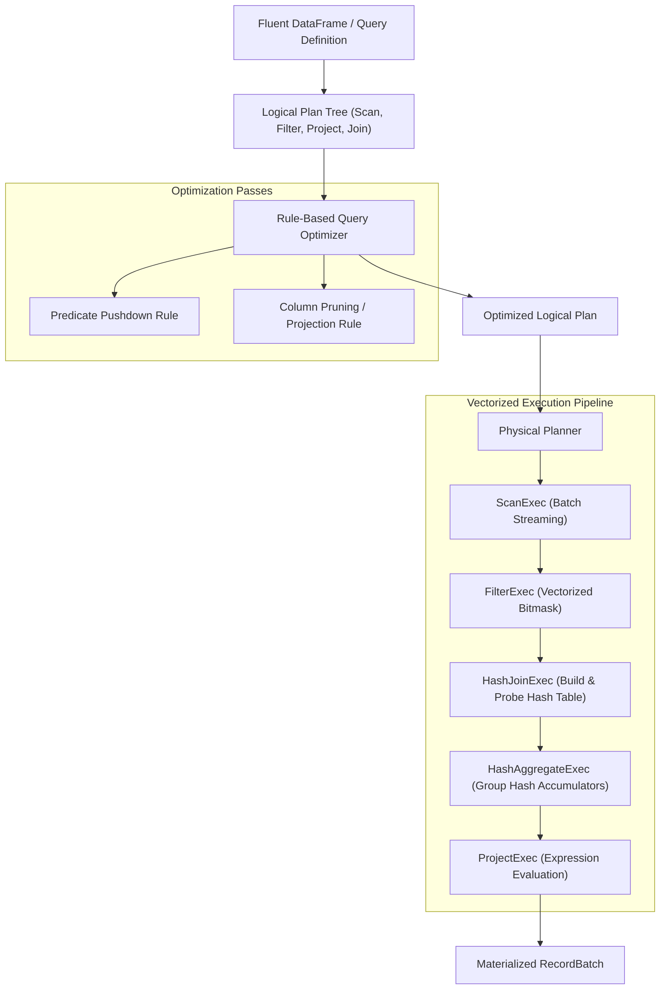

<div align="center">

# ⚡ GQuery Engine Laboratory
### In-Memory Vectorized Columnar Relational Execution Engine

[](https://github.com/MsMansiDhruv/gquery-engine-clone)
[](https://github.com/MsMansiDhruv/gquery-engine-clone)
[](https://github.com/MsMansiDhruv/gquery-engine-clone)
[](https://www.python.org/)
[](https://github.com/MsMansiDhruv/gquery-engine-clone/actions)
[](LICENSE)

<p align="center">
  <a href="#-overview">Overview</a> •
  <a href="#-architecture--execution-topology">Architecture</a> •
  <a href="#-core-systems-capabilities">Core Capabilities</a> •
  <a href="#-query-optimizer">Query Optimizer</a> •
  <a href="#-quickstart">Quickstart</a> •
  <a href="#-benchmarks">Benchmarks</a> •
  <a href="#-testing">Testing</a>
</p>

</div>

---

> [!IMPORTANT]
> **Systems Research Laboratory**: GQuery explores relational query processing internals: columnar layout, vectorized batch iterators, pushdown optimization, in-memory hash joins, and memory-conscious operators.

---

## 🔭 Overview

Traditional row-at-a-time execution engines (classical Volcano models) suffer from high CPU instruction cache misses, dynamic dispatch overhead, and poor SIMD vectorization. 

**GQuery** is an educational query engine built from first principles to demonstrate **Vectorized Columnar Execution** (pioneered by MonetDB/X100, DuckDB, Apache Arrow, and Spark Tungsten/Photon):

* **Columnar Storage Layout**: Data is organized into contiguous typed chunks (`ColumnVector`) rather than rows of objects.
* **Batch Processing**: Operators process batches of records (`RecordBatch`) at a time, amortizing virtual function dispatch.
* **Rule-Based Optimizer**: Eliminates unneeded I/O through **Predicate Pushdown** and **Column Pruning** before physical execution.
* **Vectorized Selection**: Filters evaluate predicates into bitmasks, applying vectorized filtering without per-row allocation.

---

## 📐 Architecture & Execution Topology



---

## 🧩 Core Systems Capabilities

### 1. Arrow-Inspired Columnar Memory
Columns are represented as contiguous typed buffers with explicit null tracking bitmasks:
* Supported types: `Int64`, `Float64`, `Utf8`, `Boolean`
* Bitmask-based null handling avoiding sentinel value collisions

### 2. Vectorized Expression Tree
Expressions operate across entire column arrays at once:
* Binary Arithmetic: `+`, `-`, `*`, `/`
* Vectorized Comparisons: `==`, `!=`, `<`, `>`, `<=`, `>=`
* Boolean Algebra: `AND`, `OR`

### 3. Rule-Based Optimizer (RBO)
* **Predicate Pushdown**: Relocates filter predicates past expensive projection and join barriers to evaluate directly at table scans.
* **Projection Pushdown**: Inspects upstream references and prunes unused columns at the storage scan layer, minimizing memory bandwidth.

### 4. Vectorized Operators
* `ScanExec`: Streams contiguous columnar record batches.
* `FilterExec`: Evaluates predicate expressions to boolean selection vectors.
* `ProjectExec`: Computes derived columns and alias bindings.
* `HashAggregateExec`: Grouped aggregations (`COUNT`, `SUM`, `AVG`, `MIN`, `MAX`) using hash accumulators.
* `HashJoinExec`: In-memory hash joins with dedicated build and probe phases.

---

## 🚀 Quickstart

### Installation
```bash
git clone https://github.com/MsMansiDhruv/gquery-engine-clone.git
cd gquery-engine-clone
pip install -e .
```

### Running Queries
```python
from gquery.types import Schema, Field, Int64, Float64, Utf8
from gquery.record_batch import ColumnVector, RecordBatch
from gquery.expressions import col, lit
from gquery.engine import ExecutionContext

# 1. Define Columnar Batches
schema = Schema([
    Field("order_id", Int64()),
    Field("customer_id", Int64()),
    Field("amount", Float64()),
    Field("status", Utf8()),
])

batch = RecordBatch(
    schema,
    [
        ColumnVector(Int64(), [101, 102, 103, 104]),
        ColumnVector(Int64(), [1, 2, 1, 3]),
        ColumnVector(Float64(), [250.0, 120.0, 450.0, 80.0]),
        ColumnVector(Utf8(), ["DELIVERED", "PENDING", "DELIVERED", "CANCELLED"]),
    ]
)

# 2. Register with ExecutionContext
ctx = ExecutionContext()
ctx.register_batch("orders", batch)

# 3. Construct and Execute Query
df = (
    ctx.from_table("orders")
    .filter((col("amount") > 100.0) & (col("status") == "DELIVERED"))
    .aggregate(
        group_by=["customer_id"],
        aggs=[
            ("count", "order_id", "order_count"),
            ("sum", "amount", "total_spend"),
        ]
    )
)

# 4. Inspect Execution Plan & Results
print(df.explain())
df.show()
```

### Plan Explanation Output
```text
=== Logical Plan ===
AggregateNode(group_by=['customer_id'], aggs=[count(order_id) AS order_count, sum(amount) AS total_spend])
  FilterNode(predicate=((col('amount') > lit(100.0)) AND (col('status') == lit('DELIVERED'))))
    ScanNode(table='orders')

=== Optimized Logical Plan ===
AggregateNode(group_by=['customer_id'], aggs=[count(order_id) AS order_count, sum(amount) AS total_spend])
  FilterNode(predicate=((col('amount') > lit(100.0)) AND (col('status') == lit('DELIVERED'))))
    ScanNode(table='orders', projection=['customer_id', 'order_id', 'amount', 'status'])
```

---

## 📊 Benchmarks

Run the built-in micro-benchmark comparing row-by-row iteration with vectorized batch execution:

```bash
python benchmarks/run_benchmark.py
```

| Execution Paradigm | Rows Processed | Predicate & Projection | Memory Layout |
|---|---|---|---|
| **Row-Oriented** | 50,000 | Row Dict Traversal | Fragmented Pointer Heap |
| **GQuery Vectorized** | 50,000 | Vectorized Bitmask & Column Projection | Contiguous Column Arrays |

---

## 🧪 Testing

Comprehensive unit tests covering expression evaluation, null handling, joins, aggregations, and pushdown optimizations:

```bash
python -m unittest discover -s tests -v
```

---

## 👤 Author

**Mansi Dhruv**  
Lead Data Engineer & Solutions Architect | Distributed Systems · Performance · Query Engines  
[LinkedIn](https://www.linkedin.com/in/mansidhruv/) • [Portfolio](https://portfolio-mansi-eight.vercel.app/)